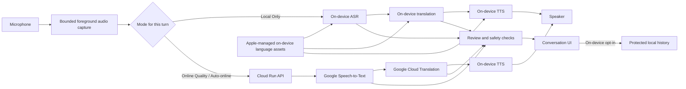

# Hybrid conversation architecture

## Product boundary and modes

The primary interaction is a turn-based conversation between a traveler and a local speaker. The user selects two languages, taps or holds the active side, speaks, reviews the recognized text and translation, and lets the app play synthesized speech. The other speaker then takes a turn in the opposite direction.

The processing mode is part of the user contract, not an invisible implementation detail:

- **Local Only** runs ASR, translation, and TTS on the iPhone using Apple-managed on-device assets. Conversation content has a zero-egress guarantee: no turn audio, transcript, or translation leaves the device. It works offline after the required system assets are installed.
- **Online Quality** sends the active turn to the Cloud Run backend, which uses US regional Google Cloud Speech-to-Text and Cloud Translation. Synthesis remains on-device. It is an ordinary explicit mode with a persistent online indicator and privacy disclosure.
- **Auto** is available to eligible Pro users. It may choose Online Quality when the network and service are available and fall back to local processing otherwise. Before recording, the UI must show which path will handle the next turn; it must never upload after showing Local Only.

Users can lock Local Only at any time. Loss of connectivity must not silently break an already downloaded local pair, and an online failure may fall back locally only if the UI updates the mode before processing or the user has explicitly enabled that Auto behavior.

Text-only history is an independent, off-by-default on-device setting. It may
store either route only when consent was captured for that turn. It uses
protected local storage, is excluded from backup, and is never synchronized by
the app. Raw audio is never history.

## Data flow

Local Only is tested with network access denied. Online turn data crosses both the app-to-Cloud-Run and Cloud-Run-to-Google-service boundaries and must be represented in the privacy inventory, disclosures, vendor terms, regional configuration, and retention evidence.

## Turn pipeline

1. The mode coordinator resolves Local Only, Online Quality, or Auto before capture. It checks Pro entitlement, pack readiness, connectivity, service policy, and the user's locked-mode preference, then displays the chosen path.
2. The audio-session coordinator selects an input route, requests microphone permission, suppresses feedback, and exposes a prominent recording state.
3. A tap starts foreground capture and a second tap stops it. Capture also stops
   at the 30-second bound; interruption, backgrounding, or cancellation tears the
   audio session down. V1 does not implement VAD, automatic endpointing, or a
   long-press push-to-talk gesture.
4. Local Only passes the bounded audio buffer only to local ASR. Online Quality uploads it over TLS to an authenticated, rate-limited Cloud Run request; the backend passes it to Google Speech-to-Text and returns the source transcript.
5. The UI shows the source transcript before or alongside translation. Low confidence, empty speech, excessive repetition, or a language mismatch produces a retry prompt rather than confident-looking output.
6. The bounded transcript is passed directly to Apple `TranslationSession` for
   Local Only or to Cloud Translation through the backend. In either production
   path it is data, never an application command, URL, or tool selection. Prompt
   boundaries become relevant only if the compile-time-disabled custom-LLM
   experiment is revisited.
7. Fidelity checks protect numbers, times, currencies, named places, negation,
   allergies, medications, and emergency terms. An extraction overflow fails
   closed into confirmation. The checks flag a turn but never invent a
   correction.
8. TTS speaks only visible, unblocked translated text through an installed system voice, regardless of translation route. Playback can be stopped immediately.
9. The turn becomes ephemeral conversation state. A capture-time consent snapshot controls protected on-device history. Saving or synchronizing audio or text anywhere else requires a different future feature and privacy review.

## Components

### Conversation and mode coordinator

A small state machine owns `ready → preparing → listening → finalizing →
reviewing → translating → confirming/speaking → ready`, with explicit
cancellation and error states and an explicit post-speech recovery side. One
cancellable task owns each immutable `TurnContext`, including route, pair,
speaker, and consent snapshots. Every mutation after suspension checks the turn
identifier so late local, network, playback, or history results cannot
overwrite the next turn.

Mode resolution should produce an immutable per-turn decision. Auto may choose the online path for a Pro user only when online processing has been disclosed and enabled, the next-turn UI identifies it, the app has a valid short-lived session, and service health permits it. The backend revalidates entitlement but the client does not depend on a durable embedded secret.

### Local engine router

The production router checks Apple Speech, Translation, and voice availability for
the selected direction and device. The app asks the system frameworks to prepare
their assets; it does not host, sign, parse, version, or roll back a custom model
pack. If no local path exists, Local Only shows that before recording and never
silently calls the backend.

V1 targets iPhone on iOS 26 without a marketing-model allowlist. Any iPhone that
can install the build may launch it. Before recording, the local router requires
on-device Listen capability for both selected languages and Translation
capability and installed readiness in both directions; otherwise Start remains
unavailable. Local Only never substitutes an online request for a missing local
capability. The current iPhone 15 Pro, iPhone 16 Pro, and iPhone 17 Pro physical
matrix is a release-qualification set rather than a runtime allowlist, and
Simulator runs cannot count as physical-device release evidence.

### Future custom model packs

The following controls apply only if a future internal or production build adds
app-managed model distribution; they are not implemented by the current Apple
framework path. Such a pack manifest would need:

- immutable artifact version, byte size, SHA-256 digest, minimum app/OS/device capability, and required free space;
- language/script/direction coverage and known limitations;
- model/runtime/voice licenses, source links, attribution text, and redistribution approval;
- evaluation report identifier and rollback predecessor;
- signature over the canonical manifest and all artifact digests.

Any future downloader must stage, verify, smoke-test, and atomically activate an
artifact with last-known-good rollback. Nothing in the current Release or
TestFlight target implements that downloader.

The MLX/Qwen path is an internal-only experiment governed by
[its separate build and artifact boundary](experimental-local-llm.md). It is
compile-time excluded from App Store Release builds and is not a fallback for
the production local pipeline.

### Online Quality backend

The Cloud Run service is on the critical path for Online Quality and Auto-online turns. It terminates public mobile requests but trusts none merely because Cloud Run accepted them. Before expensive Google API calls it validates a short-lived session/entitlement token, App Attest assertion and replay data as designed, language/direction allowlist, content type, audio byte/duration bounds, and rate/quota budget.

It holds audio, transcript, and translation only for the request unless a separately disclosed Google API term or explicit support flow requires otherwise. Structured logs contain request IDs and enumerated timings/errors, never turn content. Calls use the attached service account and narrow speech/translation/Firestore/service-usage roles declared by Terraform.

App Attest challenges, public keys/counters, StoreKit entitlement/device bindings,
opaque session-token hashes, replay challenges, notification deduplication, and
distributed quotas live in Firestore transactions with TTL where applicable.
Audio and conversation text never enter Firestore. The service is accessible
only through Cloud Armor/the HTTPS load balancer; its default Cloud Run URL is
blocked by ingress. Health failures inform Auto routing but never override a
Local Only lock.

Every availability response includes a content-free release build ID, immutable
OCI digest, runtime environment, Cloud Run revision, and an explicit
`self-reported-diagnostic` assurance label. Deployment builds embed the same
candidate ID and expected environment. The iOS client refuses to establish an
Online Quality session when the response is missing, malformed, or belongs to
another candidate/environment. It binds all four identity values into every
subsequent App Attest assertion and request, and the backend compares them
before consuming a challenge or doing StoreKit/provider work. This closes a
deployment-change race; it does not let a process attest itself. Signed release
evidence independently binds the OCI digest and revision to a Cloud Run
control-plane receipt.

### Subscription and entitlement

StoreKit 2 is the source of local purchase state, recomputed atomically from
current verified entitlements on updates and foreground. Active and Apple
billing-grace states qualify; expired, revoked, billing-retry, unknown products,
and Family Shared ownership do not. The backend represents live status checks
as observation intervals and signed server notifications as event points. Its
commutative merge is terminal for overlapping evidence, so a delayed active
response cannot revive a refund/revocation; only causally later verified
evidence can recover access. Notification deduplication and entitlement writes,
as well as session/device establishment, are atomic. Separate bounded lanes
reserve verification capacity for sessions and notifications. The backend
binds at most three active attested installations to the original transaction
and issues a 15-minute opaque session. Never send an App Store shared secret to
the app or accept a client boolean as authorization.

### On-device text history

Protected on-device storage is the only history destination. It stores only
turns consented at capture, with bounded source/translation text, route,
language codes, timestamps, safety entities, and a random ID. It excludes audio,
location, prompts, authentication data, and hidden diagnostics. Reads are paged,
records are validated before decoding, capacity is bounded, and targeted or
complete deletion reports failures honestly. The app has no iCloud/CloudKit
entitlement or synchronization path in v1.

## Reliability and UX rules

- Show source and translated text in large, separately labeled panes; do not rely on color alone.
- Surface active language, speaker side, resolved mode, online/local privacy boundary, entitlement, offline readiness, and model-download state before recording.
- Offer replay, edit-before-speak, copy, and “translate again,” but prevent edits from being mislabeled as recognized speech.
- Preserve digits and units visually and read them unambiguously. Confirm potentially dangerous allergy, medication, emergency, price, and destination turns.
- Avoid presenting the app as an emergency or medical interpreter. Display a concise limitation and point users to professional/emergency help where appropriate.
- Stop work on interruption, route loss, memory pressure, thermal escalation, incoming calls, or app backgrounding. Restore only to a safe idle/review state.
- Never queue an old local or online translation for playback after the conversation direction changes.
- If Online Quality becomes unavailable, preserve the source audio only long enough to offer an immediate retry or disclosed local fallback; otherwise discard it.

## Observability

Use structured event names with a rotating random installation/session token, resolved mode, model/service version, language pair, coarse device class, stage timings, response-size bucket, and enumerated error code. Do not log audio, source text, translations, synthesized audio, local-history content, speaker embeddings, exact location, contacts, purchase evidence, or authorization material. Make analytics consent and controls match the privacy policy, and verify redaction in client, Cloud Run, and Google Cloud logging configurations.

Quality regressions are detected with the versioned offline corpus, device and online benchmarks, crash-free/turn-completion aggregates, provider error/latency metrics, and sampled opt-in user ratings. Telemetry is not a substitute for bilingual human review.
